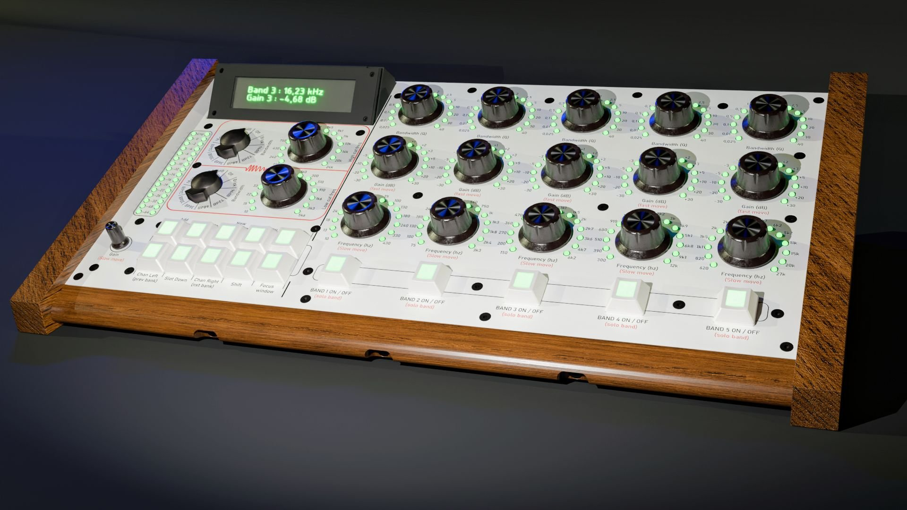
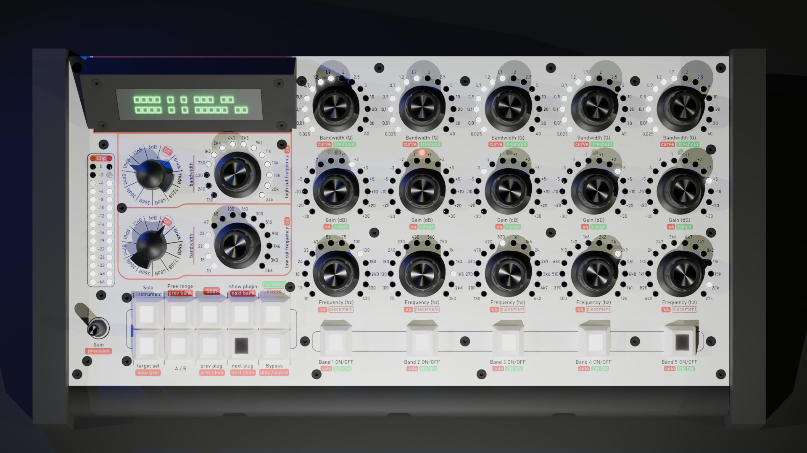

# An Arduino-based MIDI controller for precise parametric EQ VST plugin control

ProEQ is the hardware half of an EQ plug-in controller: a front panel of 18
absolute encoders, 15 mechanical keyswitches, 2 eleven-position rotary switches
and 270 LEDs around a 16×2 LCD, driven by its own ATmega board over MIDI. This
repository holds the KiCad sources, the shared part libraries, the
manufacturing data and the CAD sources. Fabrication packages and heavy 3D data
are published as GitHub Release assets rather than committed.





*Render of the panel as designed, not of a finished build: 5 bands × (gain,
bandwidth, frequency) with LED rings, the band on/off keyswitches, the two
11-position rotaries and the 16×2 LCD.*

## Hardware at a glance

| Block | Part | Qty | Bus |
|-------|------|-----|-----|
| MCU | Arduino / ATmega328 + USB-serial | 1 | — |
| LED driver | IS31FL3743A (36×11 matrix, 8-bit PWM per dot) | 2 | I2C, 0x20 and 0x23 |
| LEDs | 270 total (encoder value rings, switch backlight, VU) | 270 | via the 2 drivers |
| I/O expander | MCP23S17 (16 inputs each, pull-ups off, interrupts off) | 10 | SPI |
| Encoders | Bourns ACE-128 absolute (8-bit gray code) | 18 | through the expanders |
| Keyswitches | Matias Quiet Click + per-switch LED | 15 | through the expanders |
| Rotary switch | EAW 11-position, read as a resistor ladder | 2 | analog A0 / A1 |
| Light guides | VLP-450-R LED-to-frontplate optics | 270 | — |
| Display | 16×2 character LCD (HD44780, parallel) | 1 | 4-bit parallel |

MCP23S17 addressing: U2–U9 on `CS_0` with A2A1A0 = 000…111, U10 on `CS_1` = 001,
U11 on `CS_1` = 000. The encoder → expander port map and the switch → expander
bit map are written down in [`docs/wiring-map.txt`](docs/wiring-map.txt) and
mirrored in `encoderMCP[]` / `encoderReg[]` / `switchMCP[]` / `switchBit[]` in
[`firmware/ProEQ/SPI_functions.h`](firmware/ProEQ/SPI_functions.h). The two agree.

## Repository layout

The KiCad project sits at the repository root so that `${KIPRJMOD}` stays short
and every library path in the design is relative to the repo.

```
ProEQ.kicad_pro / .kicad_sch / .kicad_pcb   main board (current 4-layer re-spin)
fp-lib-table, sym-lib-table                 project library tables
schematics/                                 11 sub-sheets of the main board
libraries/
  symbols/ProEQ.kicad_sym                   project symbols
  symbols/vendor/                           per-part symbol originals as imported
  footprints/ProEQ.pretty/                  project footprints
  3dmodels/                                 STEP/STP models referenced by the footprints
daughterboard/                              switch spacer board (V2, current)
firmware/ProEQ/                             Arduino sketch (same name as its folder)
manufacturing/                              BOM revisions, interactive BOMs, panel cut files
mechanical/                                 FreeCAD/STEP sources for the front plate and VU
docs/                                       printed schematics, wiring maps, photos, V1 issues
archive/                                    superseded projects and libraries, kept for history
tools/check_kicad_integrity.py              static check that nothing dangles
```

The mapping from the previous layout to this one is written down in
[`docs/repository-layout.md`](docs/repository-layout.md).

## Schematic and board

- Root sheet with 11 sub-sheets: `Power supply`, `MCU and peripherals`,
  `LED driver 1`, `LED driver 2`, `I/O expander 1`…`5`, `Keyswitches`,
  `Mechanical`. 12 printed pages, exported to
  [`docs/Schematics.pdf`](docs/Schematics.pdf).
- The sub-sheet names describe function, not part numbers: the expanders are
  MCP23S17 (SPI), and the sheets are no longer named after the I2C MCP23017.
- Main board: 4 copper layers (F.Cu, In1 = "Power", In2 = "Gnd", B.Cu),
  1.6 mm, A2 sheet, KiCad 9 format (`version 20241229`).
- Root title block still carries the original French annotations
  (`Schéma général`, `ProEQ : PCB 1`, rev 3, 2024-08-18). File, folder and sheet
  names are English; the title block was left as the board's documented
  identity. Change it in the schematic if you want it consistent.

## Opening in KiCad

Requires **KiCad 9** — verified with `kicad-cli` 9.0.2 where the repo was
assembled. The sources are KiCad 9 format (PCB `version 20241229`, schematic
`version 20250114`); KiCad 8 refuses to open them.

1. Open `ProEQ.kicad_pro`.
2. No library setup is needed: `fp-lib-table` and `sym-lib-table` point at
   `${KIPRJMOD}/libraries/...`, all committed.
3. `manufacturing/` holds what you send to a fab. There is no Gerber tree in
   git, so the fabrication-toolkit plugin
   (`fabrication-toolkit-options.json`: `AUTO TRANSLATE` and `AUTO FILL` on,
   `EXCLUDE DNP` off) regenerates the plots and the order package.

## Daughter board

`daughterboard/` is the mechanical spacer board that carries the keyswitches on
the height the front plate expects. V2 is the current version; V1 is in
`archive/daughterboard-v1/` and is only a stub schematic plus STEP/WRL exports.

## Board history

| Stage | Where | What it was |
|---|---|---|
| Fabricated V1 | not in this repo (release assets) | First board sent to fab; its fault list is in [`docs/board-v1-issues.txt`](docs/board-v1-issues.txt), kept verbatim in French |
| Protoboard | `archive/protoboard/` | Bring-up board to prove the LED ring dimensions and the IS31 LED matrix before committing to the main board |
| Current re-spin | root | 4-layer main board, rev 3 schematics, designed and priced |

Nearly the whole V1 fault list is closed and marked ✅ in that file. Still open:
no case-mounting features on the board, the daughter-board area of the 3D print
needs reworking and a press-fit test, an open question about ordering LEDs and
single-board assembly at JLC, and the changed reversed-LCD dimensions and LCD
fold.

## Firmware

`firmware/ProEQ/` is an Arduino sketch imported from the project's own working
copy and kept byte-identical to it (`.ino` md5 `42adc70a0ed5a1b0be553c089027e123`).
The folder matches the sketch name so the Arduino IDE opens it directly.

It is a working prototype, not a finished product: encoder polling over SPI,
gray-code decoding and the LED side all work, but **every `sendMidiCC()` call is
still commented out**, so as committed it sends no MIDI. The LCD/LED refresh
block also keys off a hardcoded encoder index. See
[`firmware/README.md`](firmware/README.md) for the details.

Its lasting value is the wiring map: `SPI_functions.h` is the machine-readable
description of which encoder sits on which expander port, which is why it is
cross-checked against `docs/wiring-map.txt`.

Firmware is MIT licensed; the hardware is CERN-OHL-W-2.0. See
[`LICENSES.md`](LICENSES.md).

## Not in this repository

Everything here was tracked until this layout change; these stay out of git on
purpose and are kept locally or published as release assets.

| Excluded | Why | Where |
|---|---|---|
| `datasheets/` (11 MB of vendor PDFs) | Reference material, not design source | kept on disk, gitignored |
| `private/` | Personal notes and price quotes, no technical content | kept on disk, gitignored |
| Gerbers, JLC/PCBWay packages, CPL and position files | Regenerated from the PCB | release assets |
| `*.blend`, `*.pcb3d`, assembly STL/STEP exports | Heavy 3D, regenerable | release assets |
| Enclosure body STEP, cut front plate STEP, VLP light-guide STEP | Heavy assembly geometry | release assets, see [`.kicad-integrity-ignore`](.kicad-integrity-ignore) |
| KiCad autosaves, `*-backups/`, `fp-info-cache`, `*.kicad_prl` | Per-machine noise | gitignored |

## Checking the sources

Before and after any rename, run:

```sh
python3 tools/check_kicad_integrity.py
```

It resolves every sheet file, library nickname, footprint file, symbol name and
3D model path in every project, and exits non-zero on a dangling reference.
Geometry that is deliberately not distributed is listed with a reason in
`.kicad-integrity-ignore` and reported as a known exception, not an error.

State at this commit: 0 errors, 4 known exceptions. The same check reported 46
errors before the layout change — absolute `C:/Users/user/...` and `/home/user/...`
model paths left over from two different machines, footprint libraries that
pointed at a `ProjectEQ_PROTOBOARD.pretty` that never existed, a logo footprint
referenced through a `Personal:` library that was never registered, and the
main board pulling its footprints out of the protoboard folder.

## Licence

Hardware: CERN-OHL-W-2.0 — [`LICENSE`](LICENSE).
Firmware: MIT — [`firmware/LICENSE`](firmware/LICENSE).
